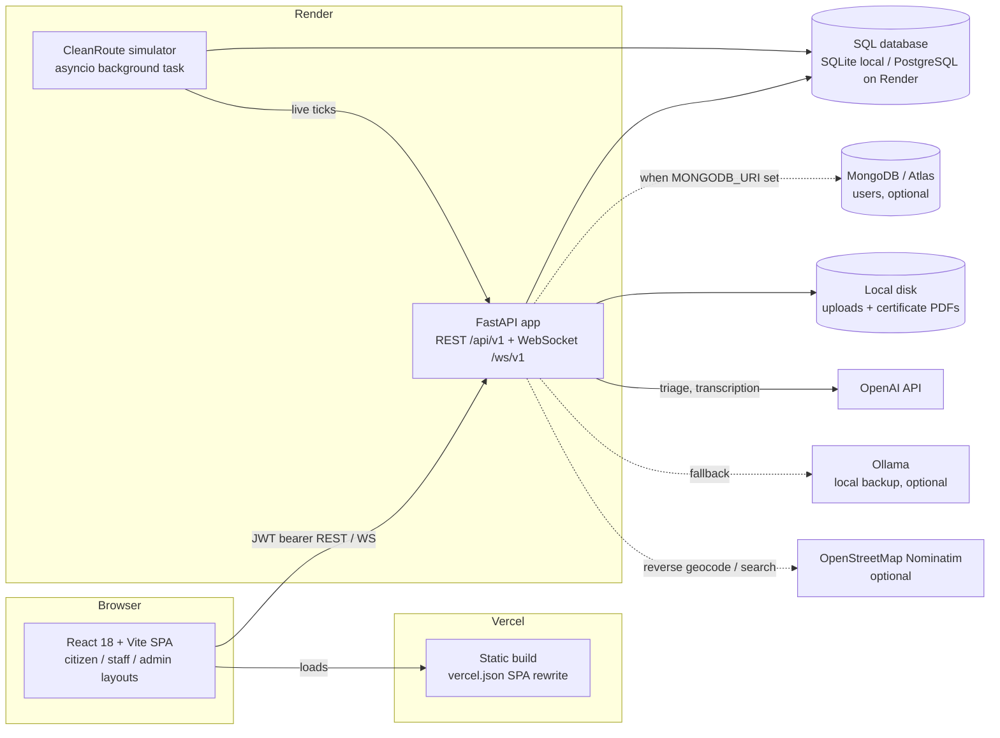
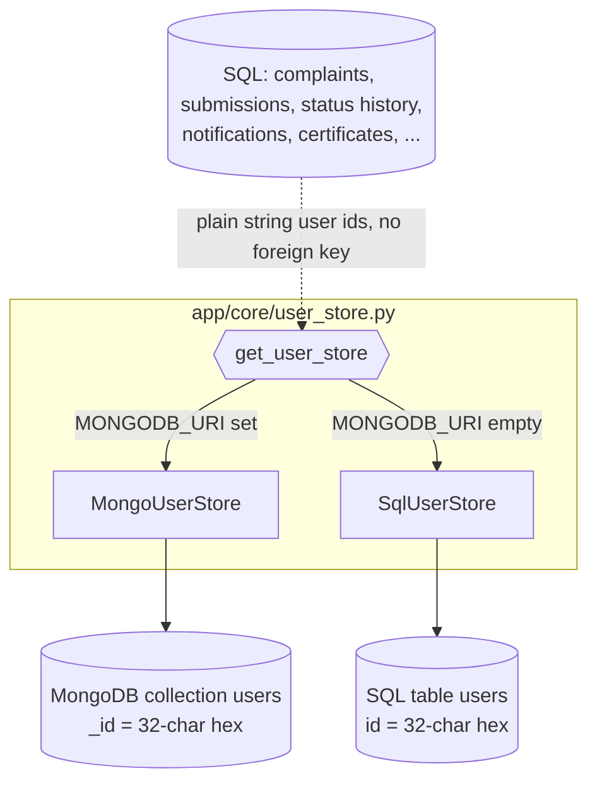
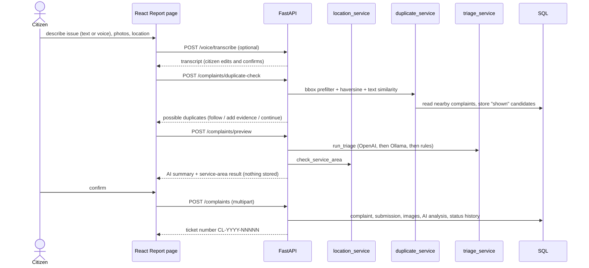
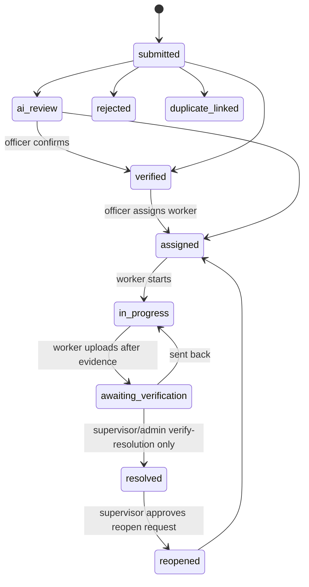
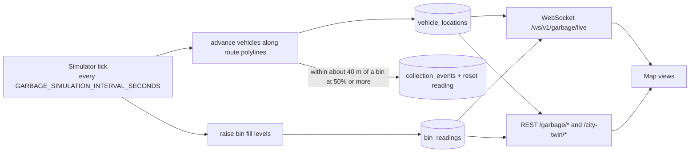
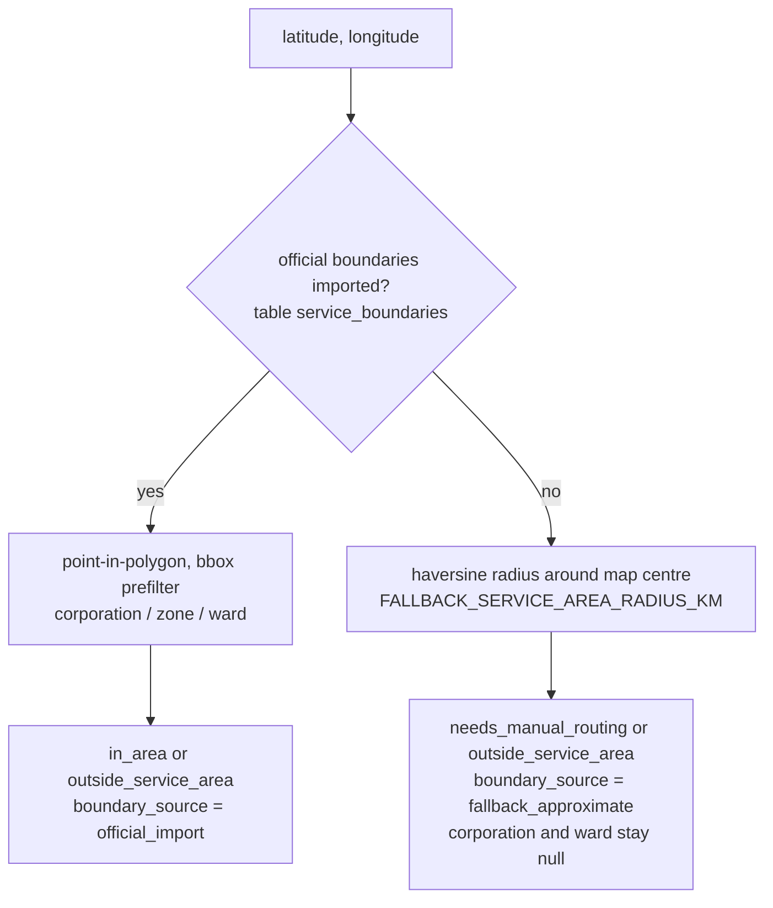
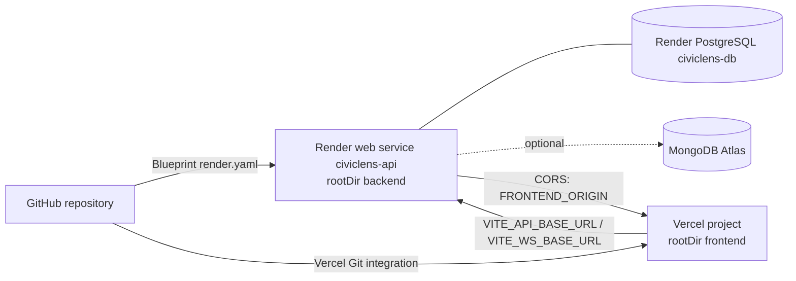

# CivicLens architecture

This document explains how the pieces fit together. Endpoint-level detail lives in `docs/API_CONTRACT.md`; product
behaviour lives in `docs/SPECIFICATION.md`. Statements below are taken from the code in this repository; items that
were not exercised are called out under "Not verified".

## Components

* The frontend is a single React application with separate citizen, staff and admin layouts. It only talks to the API
  (`VITE_API_BASE_URL`, `VITE_WS_BASE_URL`).
* The backend is FastAPI with synchronous SQLAlchemy 2.0 sessions.
* The CleanRoute simulator starts in the app lifespan when `GARBAGE_TRACKER_MODE=simulation` and
  `GARBAGE_SIMULATION_AUTOSTART=true`.

## Dual-database design

* Operational data (complaints, submissions, status history, comments, assignments, resolution evidence,
  notifications, audit log, certificates, points, garbage data, reference tables) is always in SQL.
* User accounts are in MongoDB when `MONGODB_URI` is set, otherwise in the SQL `users` table. Both stores implement the
  same interface (`get_by_id`, `get_by_email`, `create`, `update`, `list`, `get_many`) and return plain dicts.
* Other tables hold user ids as plain strings (`*_user_id`), never as database foreign keys, so the user store can be
  swapped without migrating complaint data. Display names are resolved with `get_many(ids)`.
* Consequence: if you point an existing SQL database at a different MongoDB (or vice versa), the stored user ids no
  longer resolve. Keep the two together, and for the demo seeder note it creates complaints referencing the ids of the
  demo users that existed at seeding time.
* Local development needs no MongoDB: leave `MONGODB_URI` empty.

## Data flow: reporting a complaint

The browser never sends the category, severity or department as authoritative values; the server decides them.

## Data flow: from report to verified resolution

(The full transition table is `STATUS_TRANSITIONS` in `backend/app/core/constants.py`; the diagram shows the main path.)

* `resolved` can only be reached through `POST /complaints/{ticket}/verify-resolution` by a supervisor or admin.
* Only that verification issues the citizen's certificate and civic points (`certificate_service.issue_for_complaint`).
  Merely submitting a complaint never awards points.
* Every status change inserts an immutable `status_history` row; important officer/admin actions also write `audit_logs`.

## Data flow: CleanRoute (simulated)

Every response labels the data as simulated. See `docs/API_CONTRACT.md` section 7.

## Service-area resolution

Corporation and ward are never inferred from locality names. See `docs/BOUNDARIES.md`.

## Deployment topology

Start command on Render: `alembic upgrade head && uvicorn app.main:app --host 0.0.0.0 --port $PORT`; the health check is
`/health`. See `docs/DEPLOYMENT.md`.

## Security notes

What the code does (from `backend/app/`):

* **Authentication.** Passwords are hashed with bcrypt. Access and refresh tokens are JWTs (`HS256`) signed with
  `JWT_SECRET_KEY`. The code ships an insecure development default and does not refuse to start with it, so you must set a
  strong secret in production (`render.yaml` asks Render to generate one).
* **Authorisation.** Role checks are dependencies (`require_roles`, `require_staff`, `require_office`,
  `require_supervisor`, `require_admin`) and ticket visibility is scoped per role (officer: own department; worker:
  assigned tickets; supervisor/admin: all). Out-of-scope tickets return 404.
* **Registration** always creates the `citizen` role; the `role` field in the request body is ignored (covered by a test).
* **Privacy.** Citizens do not receive other citizens' names, emails, phone numbers or exact coordinates; internal notes
  are never returned to citizens. Public certificate verification shows a first name plus last initial only.
* **Uploads.** Images are validated by content with Pillow (JPEG/PNG/WebP), size-limited, re-encoded (which drops EXIF
  and GPS metadata) and stored under server-generated names. Audio is size/type/duration limited, held in memory only, and dropped after
  transcription (`api/v1/voice.py`); audio and transcript text are not logged.
* **Server-side truth.** Severity labels, escalation rules, routing, game scores and certificate eligibility are computed on
  the server; the client cannot supply them.
* **Rate limiting** is an in-memory sliding window per process and client IP (disabled when `APP_ENV=test`).
* **CORS** allows only `FRONTEND_ORIGIN` (comma-separated) and optionally `FRONTEND_ORIGIN_REGEX`.
* **Secrets** live in backend environment variables only. `VITE_*` variables are public by design.
* **Audit.** Classification changes, assignments, status changes, verification and admin mutations are written to
  `audit_logs` (insert-only by convention).

What is not covered / not verified:

* No antivirus or content moderation on uploads; no retention job for raw uploads.
* Rate limits are per process, so they do not hold across multiple instances.
* The public WebSocket feeds (`/ws/v1/garbage/live`, `/ws/v1/city-twin/live`) are intentionally unauthenticated and
  read-only; they must not carry personal data (driver details are staff-only on REST).
* No penetration test, dependency audit or load test has been run.
* Tokens are sent as bearer headers (no auth cookies), and the SPA keeps them in `localStorage`
  (`frontend/src/lib/api.js`), so any XSS bug would expose them.
