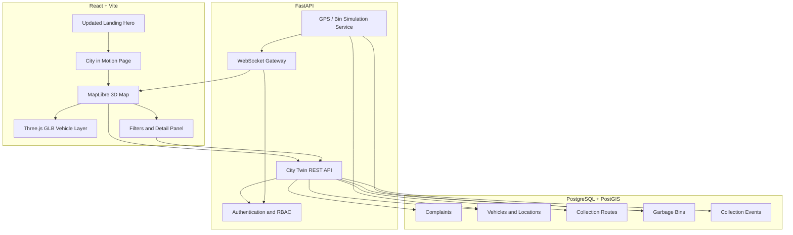
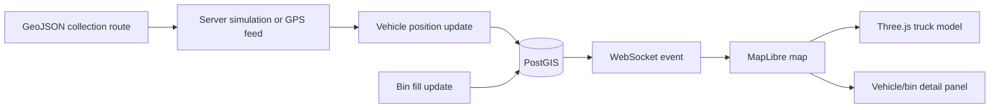

# CivicLens — Bengaluru Civic Operations Twin (3D Feature Extension)

> **Additive extension to the existing CivicLens README.**  
> This document describes the 3D feature set, hero-page update, architecture, data contracts, asset pipeline and implementation plan. It does not replace the existing CivicLens README or repeat its full complaint-management specification.

**Product name:** CivicLens — Bengaluru Civic Operations Twin  
**3D experience name:** `City in Motion`  
**Pilot geography:** Greater Bengaluru Area, Karnataka, India  
**Primary 3D stack:** MapLibre GL JS + Three.js + Blender + GLB assets  
**Backend:** Existing FastAPI + PostgreSQL/PostGIS backend  
**Live-tracking prototype mode:** Server-driven simulated GPS, explicitly labelled as simulation

---

## Contents

- [1. Purpose of this extension](#1-purpose-of-this-extension)
- [2. The recommended competition scope](#2-the-recommended-competition-scope)
- [3. Hero-page update](#3-hero-page-update)
- [4. City in Motion — feature overview](#4-city-in-motion--feature-overview)
- [5. Feature A — 3D civic complaint intelligence](#5-feature-a--3d-civic-complaint-intelligence)
- [6. Feature B — 3D garbage fleet and bin tracking](#6-feature-b--3d-garbage-fleet-and-bin-tracking)
- [7. Shared 3D interaction — verified repair transformation](#7-shared-3d-interaction--verified-repair-transformation)
- [8. User experience and screen layout](#8-user-experience-and-screen-layout)
- [9. Bengaluru map and geographic data](#9-bengaluru-map-and-geographic-data)
- [10. Recommended technology and why](#10-recommended-technology-and-why)
- [11. 3D asset strategy — Kenney, Blender and alternatives](#11-3d-asset-strategy--kenney-blender-and-alternatives)
- [12. Asset preparation and GLB pipeline](#12-asset-preparation-and-glb-pipeline)
- [13. Frontend integration](#13-frontend-integration)
- [14. FastAPI and real-time architecture](#14-fastapi-and-real-time-architecture)
- [15. Database additions](#15-database-additions)
- [16. API endpoints and WebSocket events](#16-api-endpoints-and-websocket-events)
- [17. Simulation design](#17-simulation-design)
- [18. Data flow and architecture diagrams](#18-data-flow-and-architecture-diagrams)
- [19. Performance and responsive behaviour](#19-performance-and-responsive-behaviour)
- [20. Privacy, safety and data integrity](#20-privacy-safety-and-data-integrity)
- [21. Development plan](#21-development-plan)
- [22. Acceptance checklist](#22-acceptance-checklist)
- [23. Competition demonstration script](#23-competition-demonstration-script)
- [24. Suggested repository additions](#24-suggested-repository-additions)
- [25. Useful documentation and asset links](#25-useful-documentation-and-asset-links)

---

## 1. Purpose of this extension

The existing CivicLens product already includes citizen complaint reporting, voice transcription, location capture, AI classification, severity assignment, department routing, duplicate detection, municipal workflows, appreciation certificates, CivicVerse games and CleanRoute sanitation tracking.

This extension introduces one integrated 3D experience rather than several disconnected 3D mini-projects.

### The product decision

Build **one geographic 3D map of Bengaluru** that combines two major operational features:

1. **3D civic complaint intelligence** — show real complaint locations, severity, department, status and priority on the same city map.
2. **3D garbage fleet and bin tracking** — show garbage collection vehicles moving along routes, public bins and collection progress on that same map.

A third interaction, **Verified Repair Transformation**, uses the same map and complaint records. It visually changes a complaint marker after a municipal supervisor verifies the repair. It is not a separate 3D environment.

### Why this is the best competition scope

Both main features depend on the same geographic foundation: Bengaluru roads, buildings, coordinates, map camera, map layers and real-time data updates. Combining them gives CivicLens a convincing digital-twin-style operations view without the time and complexity of building multiple separate 3D scenes.

The 3D map is not intended to be a photorealistic engineering model of every building and underground pipe in Bengaluru. It is an operational visualisation that combines real map geography with clearly identified 3D representations of civic assets.

### Product statement

> **See Bengaluru's civic problems and sanitation operations in one living map.**
>
> CivicLens turns citizen reports and municipal activity into a shared, location-aware view of the city — from a newly reported pothole to a garbage truck completing its route.

---

## 2. The recommended competition scope

### Build these two features in one 3D map

| Feature | What the judge sees | Why it matters |
|---|---|---|
| 3D civic complaint intelligence | 3D buildings, roads and coloured issue markers with a detail panel | Demonstrates AI triage in its real geographic context |
| 3D CleanRoute tracker | 3D garbage trucks, collection routes, bin fill levels and truck details | Demonstrates a practical municipal operations use case |
| Verified repair transformation | A resolved marker changes state and the ticket shows before/after evidence | Connects the citizen report to an accountable outcome |

### Do not add to this 3D scene in the first competition release

Keep these existing or future features outside the main 3D map for now:

- A separate 3D city-builder game.
- A detailed underground sewer or water-pipe model.
- A full monsoon/flood physics simulator.
- A photorealistic reconstruction of every Bengaluru building.
- VR, AR or headset support.

They may sound impressive, but they will increase asset creation, interaction, data and performance work. A polished and reliable shared map is stronger than several unfinished 3D demonstrations.

### Definition of a successful 3D prototype

A judge should be able to:

1. Open the CivicLens landing page and understand the 3D feature immediately.
2. Open `City in Motion` and see a Bengaluru map with 3D building context.
3. Filter complaint markers by severity, category, department and status.
4. Select a complaint and inspect the ticket details.
5. See at least one garbage truck moving along a predefined route.
6. Select a truck and inspect its simulated location, status, route progress and next collection point.
7. Select a bin and inspect its fill level and last collection status.
8. See a map update after a complaint is marked as verified resolved.
9. Clearly distinguish simulated GPS and sample sensor readings from real data.

---

## 3. Hero-page update

The public landing page should introduce the new 3D capability without turning the whole site into a game landing page.

### Recommended hero content

**Eyebrow:** `BUILT FOR BENGALURU · CIVIC INTELLIGENCE`  
**Headline:** `See the city. Understand the problem. Move it forward.`  
**Description:** `CivicLens connects citizen reports, AI-powered triage and municipal sanitation operations in one living view of Bengaluru.`

**Primary CTA:** `Report an issue`  
**Secondary CTA:** `Explore City in Motion`

**Small trust line:** `Multilingual reporting · Location-aware tickets · Transparent resolution tracking`

### Hero visual

Use a restrained preview of the actual City in Motion map, not a generic futuristic stock image.

The preview should contain:

- A small Bengaluru map area with low-rise and mid-rise 3D buildings.
- A few roads and green public spaces.
- Three or four complaint markers with different severity colours.
- One small garbage-truck model on a route.
- A minimal map legend.
- A small label: `3D operations preview · Demo data` when using sample records.

Avoid:

- Neon blue/purple cyberpunk styling.
- Rainbow gradients or glowing outlines.
- Giant animated counters that imply live municipal integrations.
- Fake real-time claims.
- Heavy 3D rendering in the hero before the user asks to open the full experience.

### Hero layout recommendation

Desktop:

```text
┌─────────────────────────────────────────────────────────────────┐
│ CivicLens      Report an Issue  My Reports  City in Motion  Sign in│
├─────────────────────────────────────────────────────────────────┤
│                                                                 │
│ BUILT FOR BENGALURU                 ┌──────────────────────────┐ │
│                                     │                          │ │
│ See the city.                       │  3D Bengaluru preview    │ │
│ Understand the problem.             │  • civic issue markers   │ │
│ Move it forward.                    │  • moving waste truck    │ │
│                                     │  • roads + buildings     │ │
│ [Report an issue]                   │                          │ │
│ [Explore City in Motion]            └──────────────────────────┘ │
│                                                                 │
└─────────────────────────────────────────────────────────────────┘
```

Mobile:

- Headline and description first.
- Primary CTA visible without scrolling.
- Use a lightweight static image or low-detail map preview.
- Load the interactive 3D map only after the user taps `Explore City in Motion`.

### Landing page feature strip

Directly below the hero, add three compact feature statements:

| Icon concept | Heading | Copy |
|---|---|---|
| Map pin | Reports with context | Every report is tied to a citizen-confirmed issue location. |
| Truck | Sanitation in motion | View collection routes, vehicles and public-bin status. |
| Check circle | Visible outcomes | Follow work through assignment, evidence and verification. |

---

## 4. City in Motion — feature overview

### Main experience

`City in Motion` is a full-page interactive 3D map in the Citizen Portal and Municipal Command Centre. The map uses the same geographic base, while the visible actions and data depend on the user's role.

### Shared map layers

| Layer | Visible representation | Initial default |
|---|---|---|
| Roads and buildings | Map roads and 3D building extrusions | On |
| Active complaints | Severity-coloured markers | On |
| Resolved complaints | Muted green markers, optional | Off by default |
| Garbage vehicles | 3D vehicle models | On in CleanRoute mode |
| Garbage routes | Route line on road network | On in CleanRoute mode |
| Public bins | Bin marker/model with fill status | On in CleanRoute mode |
| Parks and trees | Map data or selected 3D props | Optional |

### Map controls

- Zoom in and out.
- Rotate and tilt camera.
- Reset to Bengaluru pilot area.
- Search locality or address.
- Select a corporation/zone/ward only when current boundary data is loaded.
- Toggle map layers.
- Filter tickets.
- Switch between `Civic Issues` and `CleanRoute` views without leaving the 3D environment.
- Switch to a 2D fallback view.

### Visual design

The 3D scene should follow CivicLens civic minimalism:

- Warm neutral or light grey map surfaces.
- Muted grey buildings.
- Off-white or pale grey roads.
- Forest-green trees and public spaces.
- Dark charcoal labels.
- Restrained red, amber, blue and green status markers.
- Soft daylight; no neon lighting.
- Minimal shadows and restrained outlines.
- No gradient backgrounds.

Use 3D models as geographic objects, not as decorative clutter. The map must remain easy to read.

---

## 5. Feature A — 3D civic complaint intelligence

### Purpose

Show municipal complaints in the context of the actual area in which they were reported. This helps citizens understand nearby issues and helps officers inspect clusters, priorities and department workload.

### Complaint marker design

Use a consistent marker legend:

| Severity/status | Suggested visual | Behaviour |
|---|---|---|
| Critical | Red marker with clear warning icon | Highest visual priority; do not rely on colour alone |
| High | Amber/orange marker | Prominent but below critical |
| Medium | Blue marker | Standard attention |
| Low | Slate/grey marker | Lower priority |
| Verified resolved | Muted green marker or small check | Optional history layer |
| Under review | Neutral outline marker | Awaiting authorised assessment |

These colours are map UI conventions. Use icons, labels and accessible contrast so the information is not conveyed by colour alone.

### Marker interaction

When a user selects a marker, open a side panel rather than filling the map with large popups.

**Citizen-visible details:**

- Ticket number.
- Issue category and short summary.
- Current public status.
- Severity label, when appropriate for public display.
- Reported date/time.
- Approximate public location.
- Number of linked reports, if the incident is a confirmed duplicate group.
- Public timeline.
- `View full report` action.

**Officer-visible details:**

- All relevant ticket fields permitted by the officer's role.
- Original complaint text and original language.
- AI category, confidence and explanation.
- Severity recommendation and score.
- Department and routing rationale.
- Duplicate candidates and linked reports.
- Assignment and SLA state.
- Before/after evidence.
- Internal notes and audit history.
- Actions to correct classification, reassign, escalate or update status.

Never expose citizen phone numbers, personal email addresses, exact home addresses or other sensitive profile information in public map popups.

### Filters

The filter bar should support:

- Severity: Critical / High / Medium / Low.
- Category: Roads / Waste / Water / Electricity / Trees / Drainage / Public infrastructure.
- Status: Submitted / Verified / Assigned / In progress / Awaiting verification / Resolved / Reopened.
- Department or responsible authority.
- Date range.
- Corporation/zone/ward, if the current boundary registry supports it.
- `Show only my reports` for signed-in citizens.

### Complaint clustering

At city-level zoom, multiple nearby reports can overlap. Use map clustering or aggregated counts at lower zoom levels. When the user zooms in, reveal individual incidents.

Clustering is a display technique. It must not merge database tickets or change the duplicate-detection outcome.

### Priority ordering

The map should support the same priority score and severity logic as the municipal dashboard. Do not create a separate 3D-only severity algorithm.

Use the backend's ticket priority fields. The 3D frontend only visualises them.

---

## 6. Feature B — 3D garbage fleet and bin tracking

### Purpose

Extend the existing CleanRoute feature into the shared 3D Bengaluru map. Citizens can understand the local collection situation; sanitation officers can inspect vehicle progress, bins and routes.

### Vehicle representation

Use one recognisable, low-poly municipal garbage truck model in the first version. The model should be:

- Readable at normal map zoom.
- Small enough not to hide roads or complaint markers.
- Forest green, white or another restrained municipal colour.
- Branded with a small CivicLens demo livery if appropriate.
- Exported as `.glb`.

Use the same model for multiple vehicles initially. Vary vehicle ID, route, status and colour accent only if it helps distinguish vehicles. Do not create many unique truck models.

### Vehicle states

| State | UI label | Suggested visual |
|---|---|---|
| `moving` | En route | Truck moves along route |
| `collecting` | Collecting | Truck pauses at a bin/collection stop |
| `idle` | Idle | Truck remains parked |
| `delayed` | Delayed | Amber status chip; show delay reason if known |
| `completed` | Route completed | Truck is at depot/end point or hidden from active layer |
| `offline` | Location unavailable | Show last known position with stale-data label |

### Vehicle detail panel

On truck selection, display:

- Vehicle ID.
- Assigned corporation/zone/route.
- Current task/status.
- Last position update time.
- Current speed only when supplied by a trustworthy feed; otherwise omit it.
- Route completion percentage.
- Next collection stop.
- Estimated arrival only when calculated from a routing/ETA process; otherwise label it as a demo estimate.
- Data source badge: `Simulated GPS` or `Vehicle GPS`.

Example demo card:

```text
CL-GT-04                         SIMULATED GPS
North Zone · Route 02
Status: Collecting
Route progress: 72%
Next stop: Market Road Bin 06
Last update: 10:42:08
```

The values above are illustrative only.

### Bin representation

Show public bins as small 3D objects or simple map markers depending on zoom level.

| Fill level | Suggested state | Meaning |
|---|---|---|
| 0–50% | Normal | No collection alert |
| 51–80% | Filling up | Monitor |
| 81–95% | Collection recommended | Add to suggested collection queue |
| 96–100% | Overflow risk | High-priority sanitation alert |

These thresholds are configurable prototype rules, not municipal service standards.

On bin selection show:

- Bin ID.
- Public location label.
- Fill percentage.
- Last collection time.
- Current status.
- Next planned pickup, if scheduled.
- Data source: `Simulated sensor`, `Worker update` or `IoT sensor`.

Do not claim that a bin has an IoT sensor unless actual sensor data is connected.

### Collection routes

- Route line should follow road geometry where a routable path is available.
- Show completed segments in a muted green and remaining segments in a neutral contrasting line.
- Highlight the next collection stop.
- Show route progress in the vehicle panel.
- Keep the route visually thinner than major roads.
- Support route visibility toggling.

### Citizen and officer views

**Citizen view:**

- Nearby active collection vehicles.
- Public bin status where available.
- Scheduled collection information where verified.
- Approximate vehicle position and estimated arrival only if the data source supports it.
- No driver personal details.

**Officer view:**

- All authorised vehicle details.
- Assignment and route state.
- Collection stops.
- Overdue or high-fill bins.
- Stale location feed warnings.
- Controls to mark a collection event or correct a demo route.

---

## 7. Shared 3D interaction — verified repair transformation

This feature ties the complaint system and 3D map together. It is intentionally implemented as a status update on an existing map marker, not as another 3D world.

### Lifecycle

1. Citizen submits a report and confirms the incident location.
2. AI triage classifies the complaint and recommends severity/department.
3. An authorised officer reviews and assigns the ticket.
4. A field worker uploads completion details and an after-photo.
5. The ticket changes to `awaiting_verification`.
6. An authorised supervisor verifies or rejects the evidence.
7. Only after successful verification does the ticket become `resolved_verified`.
8. The 3D marker transitions from its open-state style to the resolved-state style.
9. Citizen tracking view updates and the existing certificate workflow becomes eligible.

### Visual treatment

When a complaint is verified resolved:

- Update the marker state and accessible label.
- Use a short, restrained transition (for example, a 300–500 ms scale/fade).
- Do not show fireworks, confetti or game-like effects in the municipal command centre.
- Keep the ticket in the resolved history layer.
- Show the before/after photo comparison in the side panel.
- Update neighbourhood statistics only from verified records.

### Integrity rules

- `resolved` and `resolved_verified` are different states if the municipality requires a supervisor verification step.
- A worker's self-reported completion must not automatically issue a certificate.
- AI image comparison can flag a possible mismatch, but cannot independently approve a repair.
- Citizen feedback can reopen or challenge a resolution, subject to an auditable workflow.
- Record who verified the issue, when it was verified and what evidence was reviewed.

---

## 8. User experience and screen layout

### Route and page

Suggested route:

```text
/city-in-motion
```

Optional tabs within the page:

```text
/city-in-motion?view=issues
/city-in-motion?view=cleanroute
```

### Desktop layout

```text
┌─────────────────────────────────────────────────────────────────────┐
│ CivicLens     Dashboard  My Reports  City in Motion  Profile         │
├───────────────┬───────────────────────────────────────┬───────────────┤
│ MAP LAYERS    │                                       │ DETAILS       │
│               │         BENGALURU 3D MAP              │               │
│ □ Complaints  │                                       │ CL-2026-00142 │
│ □ Resolved    │     3D buildings + roads              │ High · Roads  │
│ □ Vehicles    │     Issue markers                     │ In progress   │
│ □ Routes      │     Moving garbage trucks             │               │
│ □ Bins        │     Collection routes                 │ View timeline │
│               │                                       │               │
│ FILTERS       │                                       │               │
│ Severity      │                                       │               │
│ Category      │                                       │               │
│ Status        │                                       │               │
├───────────────┴───────────────────────────────────────┴───────────────┤
│ Data source: Demo simulation · Map data © OpenStreetMap contributors │
└─────────────────────────────────────────────────────────────────────┘
```

### Floating map controls

- Zoom in/out.
- Reset bearing/pitch.
- Re-centre to Bengaluru pilot map extent.
- Switch 2D/3D.
- Search place.
- Layer visibility.
- Full-screen mode.

### Responsive behaviour

**Desktop:** full map with left layer/filter rail and right details panel.  
**Tablet:** collapsible filter rail and bottom details drawer.  
**Mobile:** use a 2D-first map by default; provide an optional 3D toggle if device performance is adequate. Details open as a bottom sheet.

### Loading and error states

- Show a skeleton while map style and initial data load.
- Show a clear map-provider error with a retry option.
- If 3D rendering fails, fall back to the same data in 2D.
- If WebSocket disconnects, display `Live updates paused` and reconnect with backoff.
- If the data is simulated, keep the `Demo simulation` label visible.

---

## 9. Bengaluru map and geographic data

### Geographic foundation

Use real geographic data for:

- Road network.
- Building footprints where available.
- Parks and public spaces where available.
- Locality/address search.
- Current official Greater Bengaluru service boundaries when the correct dataset has been acquired and validated.

Use 3D assets for:

- Garbage vehicles.
- Selected public bins.
- A limited number of street/park props if they improve the demonstration.

Do not create a fake grid of modular Kenney roads and call it Bengaluru's geographic map. Kenney assets are visual props. The real map geometry should come from a map-data source.

### Default map position

Use the existing CivicLens Bengaluru default map configuration:

```js
export const BENGALURU_MAP_DEFAULT = {
  center: [77.5946, 12.9716], // MapLibre order: [longitude, latitude]
  zoom: 12,
  pitch: 55,
  bearing: -15
};
```

This is an approximate city-centre starting view, not the incident location or the citizen's current position.

### Coordinate conventions

- GeoJSON and MapLibre coordinates use `[longitude, latitude]`.
- The database can use PostGIS `geography(Point, 4326)` or `geometry(Point, 4326)` consistently.
- Validate latitude/longitude bounds in the API.
- Do not swap latitude and longitude when constructing GeoJSON.
- Store the reported issue location separately from the reporter's current device location.

### Service boundaries

Reuse the existing CivicLens GBA corporation/zone/ward boundary registry. Do not invent or hard-code a ward assignment from a locality name.

The backend should resolve the confirmed issue coordinate against the current boundary version and return the matching administrative area, or `needs_manual_routing` if no reliable match exists.

### Map data source strategy

MapLibre is a renderer; it does not itself provide a production basemap or unlimited map tiles. Configure an OSM-derived vector-tile provider or host a vector-tile service appropriate for the demo and expected usage.

For 3D building extrusions, the map style/source must expose building polygon geometry and height/levels attributes. Plain raster tiles do not provide building attributes that can be extruded.

Do not use `tile.openstreetmap.org` as an unrestricted production tile CDN. Follow the OpenStreetMap tile usage policy, display attribution and select a suitable vector tile provider or self-hosted solution for the 3D scene.

### Attribution

Display visible map attribution, for example:

```text
© OpenStreetMap contributors
```

Also comply with the selected vector-tile provider's attribution and API terms. Map data, tile rendering service and model asset licences are separate concerns.

---

## 10. Recommended technology and why

### Primary recommendation

| Layer | Technology | Responsibility |
|---|---|---|
| Frontend | React + Vite | Existing application |
| 3D geographic renderer | MapLibre GL JS | Bengaluru map, buildings, GeoJSON layers, camera and interaction |
| Custom 3D objects | Three.js | Garbage-truck GLB models and custom map objects |
| 3D authoring | Blender | Prepare, scale, optimise and export GLB assets |
| Geographic backend | PostgreSQL + PostGIS | Store/query complaint, bin, route and vehicle coordinates |
| API | Existing FastAPI backend | Serve map data and enforce permissions |
| Live updates | FastAPI WebSockets | Send vehicle, bin and complaint-state updates |
| Route data | GeoJSON + routing engine/provider | Represent collection routes along roads |

### Why MapLibre + Three.js

MapLibre provides the geographic map and camera. Its custom-layer interface can render custom WebGL content using the map's camera and can share the map depth buffer when configured as a 3D layer. Three.js can therefore be used for the garbage-truck models while MapLibre continues to handle geography, roads, building layers and map controls.

This is a better fit than creating the entire city map as a standalone Three.js scene. A standalone scene would require CivicLens to reproduce map projection, geographic positioning, pan/zoom, route alignment and map data handling itself.

### Why not make React Three Fiber the main map engine?

React Three Fiber is useful for standalone 3D scenes and game-like experiences. It is not required for the chosen geographic digital-twin feature. Use it only if a separate 3D game or virtual city scene is added later. For this version, MapLibre + Three.js is the simpler and more coherent combination.

### Frontend packages

From the existing frontend directory:

```bash
npm install maplibre-gl three
```

If using Turf for route calculations, geometry checks or interpolation helpers:

```bash
npm install @turf/turf
```

If the project uses TypeScript, add appropriate type packages where needed. If it uses JavaScript, do not add type packages just for the sake of it.

Commit the package lockfile so the competition demo runs against the same dependency versions on each machine.

---

## 11. 3D asset strategy — Kenney, Blender and alternatives

### Recommendation: use Kenney as the main low-poly asset source

**Yes — Kenney CC0 assets are a good fit for this project.** Their clean low-poly style is suitable for a stylised civic map, and the relevant City Kit and Nature Kit packs are listed as CC0 on Kenney's asset pages.

Use Kenney assets for selected visual props, not for the geographic road network itself.

| Asset pack | Use in CivicLens | Recommendation |
|---|---|---|
| [City Kit (Roads)](https://kenney.nl/assets/city-kit-roads) | Roadside props, barriers, street lights, construction fences and details | Useful for selected props; do not replace real map roads |
| [City Kit (Suburban)](https://kenney.nl/assets/city-kit-suburban) | Low-rise buildings, fences and street details | Optional; use sparingly because map data already provides buildings |
| [City Kit (Commercial)](https://kenney.nl/assets/city-kit-commercial) | A few taller buildings for visual variety | Optional; avoid covering the city with unrelated skyscrapers |
| [Nature Kit](https://kenney.nl/assets/nature-kit) | Trees, rocks, vegetation and park details | Best supporting pack for the selected visual style |

### The actual garbage truck

The garbage truck is the most important custom asset because it is the signature moving object in the demo.

Recommended approach:

1. Start from a simple low-poly truck model with a licence that permits embedding in the application, or create a basic truck in Blender.
2. Add a rear waste-compartment body, wheels, cabin, headlights and a small CivicLens demo label.
3. Keep the silhouette readable from an elevated map camera.
4. Use a restrained green/white material palette.
5. Export to GLB.
6. Test scale and orientation against a real road segment in MapLibre.

If a free vehicle model does not resemble a garbage truck, do not force it into the demo. A simple custom Blender model will look more convincing than a visually incorrect model.

### Alternative asset sources

| Source | Best use | Licence notes |
|---|---|---|
| [Kenney](https://kenney.nl/assets) | Main low-poly city props and nature assets | Check each pack's current page; selected packs above are listed as CC0 |
| [Poly Haven](https://polyhaven.com/models) | More realistic models, textures and materials | Poly Haven states its assets are CC0; style may differ from Kenney |
| [Quaternius](https://quaternius.com/) | Low-poly vehicle/environment assets | Check the exact pack's licence before downloading. Quaternius' current site includes a Quaternius Asset License as well as older pages that still refer to CC0; do not assume every new pack is CC0 |
| [Sketchfab](https://sketchfab.com/features/free-3d-models) | A specific model when nothing else fits | Licence varies by model. Check download rights, attribution, modification and redistribution conditions individually |

### Practical licence recommendation

For the competition build, prefer:

1. Kenney packs whose official pages explicitly say CC0.
2. Poly Haven assets for occasional materials/props.
3. A small original garbage-truck model created by the team.

For any model downloaded elsewhere, inspect the exact asset page and licence. Do not assume that the word `free` means CC0 or permits every kind of use.

### Asset inventory file

Create `docs/assets/ASSET_CREDITS.md` and track:

| File | Source URL | Creator | Licence | Download date | Modified? |
|---|---|---|---|---|---|
| `garbage-truck.glb` | Team-created / source URL | Team or source creator | Record exact licence | YYYY-MM-DD | Yes/No |
| `tree-small.glb` | Kenney Nature Kit | Kenney | CC0 (verify pack page) | YYYY-MM-DD | Yes/No |
| `road-barrier.glb` | Kenney City Kit Roads | Kenney | CC0 (verify pack page) | YYYY-MM-DD | Yes/No |

Even if attribution is not legally required for a CC0 asset, keep the inventory for competition submissions, future contributors and licence audits.

---

## 12. Asset preparation and GLB pipeline

### Preferred web format

Use `.glb` (binary glTF) for the runtime models. It packages geometry, materials and textures in a convenient web-friendly file.

### Blender workflow

1. Download the asset pack and identify the required model files.
2. Import the model into Blender.
3. Remove objects not required by the web scene.
4. Apply transforms and set a consistent forward direction.
5. Set the model origin/pivot to a useful point, ideally the centre of the vehicle footprint or its ground contact point.
6. Check scale against a plausible road width.
7. Reduce unnecessary geometry and material slots.
8. Reuse materials and texture atlases where possible.
9. Export as glTF Binary (`.glb`).
10. Test the result in a browser using Three.js GLTFLoader.

### Model orientation convention

Choose one documented vehicle-forward direction and keep it consistent for all models. The runtime animation should compute heading from the route segment and rotate the model to match the chosen forward axis.

If the model points along a different axis, correct it in Blender or apply one documented orientation offset in code. Do not scatter arbitrary rotation fixes across multiple components.

### Asset size targets

For a competition web demo, keep the first garbage-truck GLB lightweight. As a practical target, aim for a few megabytes or less, preferably smaller, while keeping the silhouette clear. Use compressed geometry/textures only when supported by the chosen loader and hosting pipeline.

Do not load the full Kenney pack into the browser. Copy only the assets that the application actually uses.

### Suggested asset directory

```text
frontend/
└── public/
    └── models/
        ├── vehicles/
        │   └── garbage-truck.glb
        ├── bins/
        │   └── public-bin.glb
        └── props/
            ├── street-tree.glb
            └── road-barrier.glb
```

---

## 13. Frontend integration

### Suggested frontend structure additions

```text
src/
├── features/
│   └── city-in-motion/
│       ├── components/
│       │   ├── CityMap.jsx
│       │   ├── MapToolbar.jsx
│       │   ├── MapLayerControl.jsx
│       │   ├── ComplaintFilters.jsx
│       │   ├── ComplaintMarkerLayer.jsx
│       │   ├── VehicleLayer.jsx
│       │   ├── BinLayer.jsx
│       │   ├── RouteLayer.jsx
│       │   ├── SelectedFeaturePanel.jsx
│       │   ├── MapLegend.jsx
│       │   └── DataSourceBadge.jsx
│       ├── hooks/
│       │   ├── useCityMapData.js
│       │   ├── useGarbageLiveFeed.js
│       │   └── useMapSelection.js
│       ├── services/
│       │   └── cityTwinApi.js
│       ├── utils/
│       │   ├── geojson.js
│       │   ├── routeMath.js
│       │   └── mapConfig.js
│       └── CityInMotionPage.jsx
│
└── pages/
    └── CityInMotion.jsx
```

### Map initialisation

Create one MapLibre instance using a React `ref` and initialise it in `useEffect`. Destroy the map and listeners on unmount. Do not create a new map on every React render.

Illustrative JavaScript setup:

```jsx
import { useEffect, useRef } from "react";
import maplibregl from "maplibre-gl";
import "maplibre-gl/dist/maplibre-gl.css";

const BENGALURU_CENTER = [77.5946, 12.9716];

export default function CityMap({ styleUrl, onReady }) {
  const containerRef = useRef(null);
  const mapRef = useRef(null);

  useEffect(() => {
    if (!containerRef.current || mapRef.current) return;

    const map = new maplibregl.Map({
      container: containerRef.current,
      style: styleUrl,
      center: BENGALURU_CENTER,
      zoom: 12,
      pitch: 55,
      bearing: -15,
      attributionControl: true
    });

    map.addControl(new maplibregl.NavigationControl(), "top-right");
    mapRef.current = map;

    map.once("load", () => {
      onReady?.(map);
    });

    return () => {
      map.remove();
      mapRef.current = null;
    };
  }, [styleUrl, onReady]);

  return <div ref={containerRef} className="h-full w-full" />;
}
```

Implementation notes:

- Keep `styleUrl` in environment/configuration, not hard-coded in multiple components.
- Ensure `onReady` has a stable identity (for example, `useCallback`) or remove it from dependencies in a safe, deliberate way.
- Add map sources/layers after the style has loaded.
- Re-add custom data sources after a style change if the chosen map style removes custom layers.
- Handle map load errors and fall back to 2D or a useful error message.
- Use `ResizeObserver` or the map's `resize()` method when side panels open/close and change the map container size.

### Add the 3D building layer

If the selected vector-tile style contains building polygons and appropriate `height` / `render_height` / levels attributes, add a `fill-extrusion` layer using the actual source-layer name exposed by that provider.

Illustrative layer configuration (source and source-layer names must be adapted to the selected provider):

```js
map.addLayer({
  id: "civiclens-3d-buildings",
  type: "fill-extrusion",
  source: "city-vector-source",
  "source-layer": "building",
  minzoom: 14,
  paint: {
    "fill-extrusion-color": "#D8DAD3",
    "fill-extrusion-height": [
      "coalesce",
      ["get", "render_height"],
      ["*", ["coalesce", ["get", "height"], 8], 1]
    ],
    "fill-extrusion-base": [
      "coalesce",
      ["get", "render_min_height"],
      0
    ],
    "fill-extrusion-opacity": 0.88
  }
});
```

This is an illustrative example, not a provider-independent drop-in snippet. Check the selected vector source's layer names and height property schema. A provider may use different attribute names or may not offer building heights.

### Complaint markers

Use a GeoJSON source for complaint locations. For many records, use a circle/symbol layer and clustering at low zoom levels. Add click handling to read the selected feature properties and open the React side panel.

A complaint feature should contain only map-safe properties, for example:

```json
{
  "type": "Feature",
  "geometry": {
    "type": "Point",
    "coordinates": [77.5946, 12.9716]
  },
  "properties": {
    "ticket_id": "CL-2026-00142",
    "category": "roads",
    "severity": "high",
    "status": "in_progress",
    "priority_score": 82,
    "public_summary": "Large pothole reported near a bus stop"
  }
}
```

Never put citizen phone numbers, email, full name or private address in map feature properties.

### Three.js garbage truck rendering

Use a MapLibre custom style layer for the 3D model when the truck must align with the map camera and geographic coordinates. Load the `.glb` through Three.js `GLTFLoader`, position it using a geographic-to-Mercator transformation, and update its heading from the route direction.

MapLibre custom layers share the map's WebGL rendering context. Follow the MapLibre custom-layer lifecycle carefully (`onAdd`, `render`, `onRemove`), and ensure Three.js does not clear or reset the map's drawing buffers unexpectedly. Refer to the official MapLibre custom-layer examples before implementing the integration.

For the first milestone, a simpler MapLibre symbol/HTML marker can be used to validate vehicle location and route logic. Replace it with the GLB vehicle after the geographic tracking works. This is a risk-reducing development sequence, not a change to the final design.

### Map selection and panel state

Keep the map instance outside normal React render state (use a ref). Keep selected feature ID, filters, selected layer toggles and drawer visibility in React state. When filters change, update the map source/filter rather than rebuilding the map.

---

## 14. FastAPI and real-time architecture

### Backend responsibilities

The backend remains the source of truth for:

- Complaint status and severity.
- Public map-safe complaint fields.
- Corporation/zone/ward resolution.
- Vehicle route and latest reported location.
- Bin fill level and collection events.
- Whether a position is live, simulated or stale.
- User/role permissions.

The frontend must not invent complaint records or independently decide a truck's authoritative status.

### Real-time transport

Use FastAPI WebSockets for the prototype's live update feed. A connected `City in Motion` page subscribes to the city/zone data it is authorised to see.

For a single-process competition demo, an in-process simulator can publish updates to connected clients. For multi-worker or production deployment, use Redis pub/sub or a message broker so that updates reach WebSocket connections served by different backend workers.

### Update frequency

For a simulation, update vehicle positions every 1–3 seconds if animation smoothness requires it. The browser may interpolate between server updates for smooth movement. Bin readings can update less frequently, for example every 15–60 seconds, because a bin's fill percentage does not need frame-rate updates.

Do not transmit large full-city datasets every second. Send only changed vehicle/bin/ticket records or a compact snapshot on initial connection.

---

## 15. Database additions

Reuse the existing CivicLens `complaints`, `users`, `departments`, `workers` and `status_history` tables. Add the following tables or equivalent model fields.

### `garbage_vehicles`

| Field | Type | Purpose |
|---|---|---|
| `id` | UUID | Primary key |
| `vehicle_code` | VARCHAR | Public/demo identifier such as `CL-GT-04` |
| `corporation_id` | UUID / nullable FK | Responsible service area |
| `route_id` | UUID / nullable FK | Current route |
| `status` | ENUM/VARCHAR | moving, collecting, idle, delayed, completed, offline |
| `data_source` | ENUM/VARCHAR | simulated, gps_device, manual |
| `is_active` | BOOLEAN | Active vehicle flag |
| `created_at` | TIMESTAMP | Record creation |
| `updated_at` | TIMESTAMP | Last metadata update |

### `garbage_routes`

| Field | Type | Purpose |
|---|---|---|
| `id` | UUID | Primary key |
| `route_code` | VARCHAR | Route identifier |
| `name` | VARCHAR | Human-readable name |
| `area_id` | UUID / nullable FK | Corporation/zone/ward mapping |
| `geometry` | LINESTRING, SRID 4326 | Ordered route geometry |
| `is_simulated` | BOOLEAN | Demo data marker |
| `created_at` | TIMESTAMP | Record creation |

### `vehicle_locations`

| Field | Type | Purpose |
|---|---|---|
| `id` | BIGSERIAL / UUID | Primary key |
| `vehicle_id` | UUID FK | Vehicle |
| `location` | GEOGRAPHY(Point, 4326) | Current/recorded location |
| `heading_degrees` | REAL | Direction of travel |
| `speed_kmh` | REAL / nullable | Only when known/simulated and labelled |
| `route_progress` | REAL | 0–100 percentage |
| `data_source` | ENUM/VARCHAR | simulated, gps_device, manual |
| `recorded_at` | TIMESTAMP | Position time |

For larger deployments, keep a latest-location table/materialised view separately from the historical location stream. Avoid querying the entire GPS history for every map refresh.

### `garbage_bins`

| Field | Type | Purpose |
|---|---|---|
| `id` | UUID | Primary key |
| `bin_code` | VARCHAR | Public/demo identifier |
| `location` | GEOGRAPHY(Point, 4326) | Bin coordinates |
| `public_label` | VARCHAR | Location label |
| `fill_percentage` | SMALLINT | 0–100 |
| `status` | VARCHAR | normal, filling, collection_recommended, overflow_risk |
| `data_source` | VARCHAR | simulated, worker_update, iot_sensor |
| `last_collected_at` | TIMESTAMP / nullable | Latest collection time |
| `last_reading_at` | TIMESTAMP | Reading timestamp |

### `collection_events`

| Field | Type | Purpose |
|---|---|---|
| `id` | UUID | Primary key |
| `bin_id` | UUID FK | Collected bin |
| `vehicle_id` | UUID FK / nullable | Collecting vehicle |
| `worker_id` | UUID FK / nullable | Worker if recorded |
| `event_type` | VARCHAR | collected, inspected, skipped, overflow_reported |
| `evidence_url` | TEXT / nullable | Optional image evidence |
| `recorded_at` | TIMESTAMP | Event time |
| `data_source` | VARCHAR | simulated, worker_update, iot_sensor |

### Optional `map_data_versions`

If administrative polygons or road/asset datasets are imported, track their source, version, import date, coordinate reference system and licence/attribution requirements. This prevents silent changes in corporation/ward assignment.

### Indexes

Create spatial indexes for the location fields using GiST. Add btree indexes for `vehicle_id`, `recorded_at`, `status`, `route_id` and frequently filtered complaint fields. Add a suitable time-series retention policy for high-frequency vehicle location history if data volume grows.

---

## 16. API endpoints and WebSocket events

These endpoints extend the existing FastAPI API. Keep existing complaint endpoints as defined in the original README.

### Map data endpoints

| Method | Endpoint | Purpose |
|---|---|---|
| `GET` | `/api/city-twin/summary` | Map counts and data source metadata for an authorised area |
| `GET` | `/api/city-twin/complaints` | Map-safe complaint GeoJSON or paginated feature data |
| `GET` | `/api/city-twin/complaints/{ticket_id}` | Complaint detail under role-based access |
| `GET` | `/api/city-twin/vehicles` | Latest visible vehicle positions and statuses |
| `GET` | `/api/city-twin/vehicles/{vehicle_id}` | Vehicle and current route detail |
| `GET` | `/api/city-twin/routes` | Active collection routes as GeoJSON |
| `GET` | `/api/city-twin/bins` | Bin locations and current fill levels |
| `GET` | `/api/city-twin/bins/{bin_id}` | Bin detail and collection history |
| `GET` | `/api/city-twin/layers/config` | Available layers and their visibility defaults |

### Officer action endpoints

| Method | Endpoint | Purpose |
|---|---|---|
| `PATCH` | `/api/garbage/vehicles/{vehicle_id}/status` | Update authorised vehicle status |
| `POST` | `/api/garbage/vehicles/{vehicle_id}/assign-route` | Assign an authorised route |
| `POST` | `/api/garbage/bins/{bin_id}/collection-events` | Record a collection/inspection event |
| `POST` | `/api/city-twin/simulation/start` | Start demo simulation in development/admin mode |
| `POST` | `/api/city-twin/simulation/stop` | Stop demo simulation in development/admin mode |

Do not expose simulation control to public users. In production mode these endpoints should be disabled or protected by an admin-only feature flag.

### WebSocket

```text
/ws/city-twin/live
```

The initial connection should authenticate the user and validate their role/area scope. Avoid placing long-lived access tokens in query strings where possible; use a secure cookie or a short-lived WebSocket ticket obtained through an authenticated API call.

### Example event: vehicle update

```json
{
  "type": "vehicle.position.updated",
  "data": {
    "vehicle_id": "6ec4b535-8dd0-46f3-95f9-8c2af63c83b0",
    "vehicle_code": "CL-GT-04",
    "longitude": 77.5946,
    "latitude": 12.9716,
    "heading_degrees": 92.0,
    "route_progress": 72,
    "status": "moving",
    "data_source": "simulated",
    "recorded_at": "2026-11-21T10:42:08+05:30"
  }
}
```

### Example event: bin update

```json
{
  "type": "bin.fill.updated",
  "data": {
    "bin_id": "0b8d3d8d-779c-44b0-a761-f3415cd56b5f",
    "bin_code": "CL-BIN-06",
    "fill_percentage": 94,
    "status": "overflow_risk",
    "data_source": "simulated",
    "recorded_at": "2026-11-21T10:42:08+05:30"
  }
}
```

### Example event: complaint status update

```json
{
  "type": "complaint.status.updated",
  "data": {
    "ticket_id": "CL-2026-00142",
    "status": "resolved_verified",
    "severity": "high",
    "longitude": 77.5946,
    "latitude": 12.9716,
    "public_summary": "Road damage repair verified",
    "updated_at": "2026-11-21T11:05:00+05:30"
  }
}
```

All sample IDs, coordinates, timestamps and records above are illustrative demo values.

---

## 17. Simulation design

### Why a backend-driven simulation?

A client-only animation can make each browser show a different truck position. A backend-driven simulator gives every connected user the same authoritative demo state and makes the prototype behave more like a real tracking system.

### Simulation route

For each demo vehicle:

1. Store an ordered route as a GeoJSON `LineString`.
2. Store the vehicle's current progress along the route.
3. Advance progress in a controlled server-side simulation loop.
4. Interpolate the position between adjacent route coordinates.
5. Calculate heading from the current segment.
6. Publish only the updated vehicle state.
7. Pause briefly at collection stops and update the relevant bin/collection event.
8. Loop or stop at the depot based on the demo configuration.

### Simulation pseudocode

```python
async def tick_vehicle(vehicle, route, delta_seconds):
    """Advance one clearly-labelled demo vehicle along its route."""
    vehicle.progress_m += vehicle.demo_speed_mps * delta_seconds

    position = interpolate_route_position(
        route.geometry,
        vehicle.progress_m,
    )

    heading = calculate_route_heading(
        route.geometry,
        vehicle.progress_m,
    )

    vehicle.latest_longitude = position.longitude
    vehicle.latest_latitude = position.latitude
    vehicle.heading_degrees = heading
    vehicle.route_progress = calculate_percent(
        vehicle.progress_m,
        route.length_m,
    )

    await publish_vehicle_update(vehicle)
```

This is illustrative pseudocode. Add boundary checks, route-end behaviour, persistence, concurrency protection and proper shutdown handling in the actual implementation.

### Simulation controls

Provide an admin/developer-only control panel:

- Start simulation.
- Pause simulation.
- Reset vehicles to route start.
- Set simulation speed multiplier.
- Reset bin fill values.
- Trigger a collection stop.

Display a persistent banner on the map:

```text
DEMO MODE — Vehicle locations and bin readings are simulated.
```

If actual GPS or IoT data is connected in a future deployment, the badge should change based on the source of each record, not a manual UI assumption.

### Estimated arrival time

For the competition version, either omit ETA or call it `Demo ETA`. Do not present an arbitrary countdown as a real travel-time prediction. A production ETA should consider route geometry, road network, traffic/speed data, stop duration and the timestamp/quality of the latest location.

---

## 18. Data flow and architecture diagrams

### Overall 3D feature architecture



### Complaint map lifecycle

```mermaid
flowchart LR
    REPORT[Citizen report] --> TRIAGE[AI triage]
    TRIAGE --> TICKET[Structured ticket]
    TICKET --> GEO[Resolve issue coordinate]
    GEO --> MAPMARKER[Complaint marker on 3D map]
    MAPMARKER --> ASSIGN[Officer assigns work]
    ASSIGN --> EVIDENCE[Worker uploads evidence]
    EVIDENCE --> VERIFY[Supervisor verifies]
    VERIFY --> RESOLVED[Marker becomes resolved]
    RESOLVED --> CERT[Existing certificate workflow]
```



### Garbage tracking lifecycle



---

## 19. Performance and responsive behaviour

The 3D map must be visually impressive but should remain responsive on normal student laptops and mid-range phones.

### Performance rules

- Load the 3D map only when the user opens `City in Motion`.
- Lazy-load Three.js and the GLB model.
- Use one truck model for multiple vehicle instances when practical.
- Reuse materials and geometry; avoid creating a new material for every marker.
- Use MapLibre circle/symbol layers for large complaint sets instead of a separate Three.js mesh per complaint.
- Cluster complaints at city-level zoom.
- Load 3D building extrusions only above a suitable zoom threshold.
- Limit decorative objects to the current viewport.
- Send compact WebSocket deltas, not the entire dataset for every update.
- Interpolate vehicle movement client-side between server positions.
- Throttle expensive map queries and avoid repeated map reinitialisation.
- Clean up WebSocket connections, map listeners and Three.js resources when the page unmounts.
- Provide a 2D mode if WebGL is unavailable or the device is slow.

### Quality target

The map should maintain a usable frame rate during the demo with:

- One map instance.
- One garbage-truck GLB model instanced or reused for several vehicles.
- A limited demo vehicle count.
- A reasonable number of complaint markers, clustered at low zoom.
- A limited bin set in the visible pilot area.

Do not promise a fixed FPS across all devices. Measure on the actual competition laptop and one mobile device.

### Mobile behaviour

- Default to 2D or reduced 3D pitch on lower-powered devices.
- Keep complaint and bin markers tappable.
- Use a bottom sheet for details.
- Hide non-essential decorative models.
- Provide list view as an alternative to the map.

---

## 20. Privacy, safety and data integrity

### Location privacy

- The 3D map uses the **issue location**, not the reporter's live device location, unless the citizen explicitly chooses to share it for a specific purpose.
- Ask browser location permission only when needed.
- Allow manual pin placement when permission is denied or inaccurate.
- Do not display a citizen's exact home location or profile details in a public map.
- Use approximate public map coordinates where exact reporting coordinates could reveal sensitive information.
- Apply role/area authorisation to vehicle and worker data.

### Live vehicle data

- Do not expose driver phone numbers, personal details or private schedules on the public map.
- For demo vehicles, display `Simulated GPS` at the vehicle and page levels.
- If a feed becomes stale, show `Last update ...` and `Location may be outdated`.
- Do not animate a vehicle as if it is moving when the feed is offline unless it is explicitly in simulation mode.

### Complaint integrity

- The map is a view of ticket records, not an alternate source of truth.
- Severity and priority are inherited from the complaint service.
- The frontend cannot mark a complaint verified resolved by changing marker colour locally.
- Only an authorised backend action can change the verified status.

### Map and asset licences

- Follow the map/vector tile provider terms.
- Display required OSM/provider attribution.
- Record model licences and asset sources.
- Do not redistribute asset packs as standalone downloads unless their licence permits it.
- Keep the licence inventory in version control.

---

## 21. Development plan

Implement the 3D feature in small, testable milestones. Do not begin with moving 3D models before the underlying map works.

### Milestone 1 — Static Bengaluru 3D map

**Goal:** render the selected Bengaluru map area with roads and buildings.

Tasks:

- Add MapLibre GL JS and CSS.
- Configure a vector tile style/provider.
- Add the Bengaluru initial camera position.
- Render 3D building extrusions using the provider's actual building source layer.
- Add map attribution.
- Add navigation controls and reset camera.
- Add 2D fallback.

**Exit condition:** map loads reliably and the camera can pan, zoom, rotate and pitch.

### Milestone 2 — Complaint intelligence layer

**Goal:** show actual CivicLens demo tickets on the map.

Tasks:

- Add `/api/city-twin/complaints`.
- Return only map-safe GeoJSON properties.
- Render severity and status markers.
- Add category/severity/status filters.
- Add marker clustering.
- Connect marker click to complaint detail panel.

**Exit condition:** selecting a marker opens the matching ticket and filters update both map and list.

### Milestone 3 — Truck and bin model

**Goal:** render one garbage truck and a small set of public bins.

Tasks:

- Create/download a correctly licensed garbage-truck GLB.
- Prepare the model in Blender.
- Test a simple map marker first.
- Add Three.js custom layer integration.
- Align truck model with road coordinates.
- Render bin markers/models and status colours.

**Exit condition:** truck and bins align with the correct map locations and do not drift when the camera moves.

### Milestone 4 — Routes and movement simulation

**Goal:** animate a truck along a route using backend data.

Tasks:

- Add route table and GeoJSON endpoint.
- Create two or three fictional demo routes within a selected Bengaluru pilot locality.
- Implement server-side route interpolation.
- Broadcast vehicle updates via WebSocket.
- Smooth movement in the browser.
- Add route progress and selected vehicle panel.

**Exit condition:** all connected clients see the same simulated vehicle location and route progress.

### Milestone 5 — Bin status and collection events

**Goal:** connect bins to the vehicle workflow.

Tasks:

- Seed fictional bin locations and initial fill levels.
- Add fill-level updates.
- Show overflow-risk bins.
- Simulate a truck arriving at a bin.
- Record a collection event and update bin status.

**Exit condition:** a collection event visibly changes the selected bin's state and the event appears in its history.

### Milestone 6 — Verified complaint resolution

**Goal:** make the map reflect the complaint lifecycle.

Tasks:

- Subscribe to complaint status events.
- Update map marker after backend status change.
- Add resolved-history layer.
- Show before/after evidence in the panel.
- Trigger existing certificate eligibility only after supervisor verification.

**Exit condition:** officer verification updates the citizen map and does not generate a certificate before verification.

### Milestone 7 — Hero integration and final polish

**Goal:** make the feature discoverable and competition-ready.

Tasks:

- Add the new hero copy and preview.
- Add `Explore City in Motion` CTA.
- Add demo-mode/source labels.
- Test mobile and low-performance fallback.
- Verify map attribution and asset licence inventory.
- Rehearse the competition demo using seeded data.

**Exit condition:** a first-time judge can understand and navigate the feature without developer explanation.

---

## 22. Acceptance checklist

### Hero page

- [ ] Hero clearly introduces the Bengaluru 3D operations feature.
- [ ] `Report an issue` CTA still works.
- [ ] `Explore City in Motion` opens the 3D page.
- [ ] Hero preview is lightweight and has a 2D/static fallback.

### Geographic map

- [ ] Map opens at the configured Bengaluru view.
- [ ] Map uses `[longitude, latitude]` coordinate order.
- [ ] Current map and tile attribution is visible.
- [ ] 3D building layer uses actual source attributes.
- [ ] Pan, zoom, pitch and bearing work.
- [ ] Map errors display a useful fallback.

### Civic complaints

- [ ] Map shows tickets from the backend.
- [ ] Severity/status filters work.
- [ ] Marker selection opens the correct ticket.
- [ ] Clustering works at lower zoom levels.
- [ ] Public map payload contains no private citizen data.
- [ ] Verified resolution updates marker state from backend.

### Garbage tracking

- [ ] At least one garbage truck model renders.
- [ ] Truck route is visible.
- [ ] Truck position changes along the route.
- [ ] Model heading matches travel direction.
- [ ] Vehicle panel shows status and route progress.
- [ ] Bins display fill level and data-source label.
- [ ] Collection event updates bin state.
- [ ] Simulated data is always labelled as simulated.

### Reliability and performance

- [ ] Map is created only once per mounted page.
- [ ] Map/WebSocket/Three.js resources are cleaned up on unmount.
- [ ] WebSocket reconnects after a temporary disconnect.
- [ ] Stale feed is visibly marked.
- [ ] 2D fallback works when WebGL is unavailable.
- [ ] Page remains usable on a mid-range mobile device.

### Legal and trust

- [ ] Map attribution is correct.
- [ ] Every downloaded model has a recorded licence.
- [ ] No public map layer reveals personal citizen details.
- [ ] No simulated truck is described as an actual municipal vehicle.
- [ ] No sample bin fill reading is described as a real sensor reading.

---

## 23. Competition demonstration script

Use one coherent story, not a feature-by-feature tour.

### Suggested 2–3 minute demonstration

1. **Open the hero page.** Show the headline: `See the city. Understand the problem. Move it forward.`
2. **Open City in Motion.** Show the Bengaluru map with 3D buildings and complaint markers.
3. **Select a high-priority road complaint.** Open the detail panel and explain that the ticket comes from the same AI triage flow used by citizen reporting.
4. **Switch on CleanRoute.** Show a garbage truck moving along its collection route. Point out the `Simulated GPS` badge so the demonstration is transparent.
5. **Select a bin.** Show its fill percentage and collection state.
6. **Trigger a demo collection event.** Show the vehicle reaching the selected bin and the bin status updating.
7. **Return to the complaint.** Use the officer workflow to mark the repair as awaiting verification and then verify it as a supervisor.
8. **Show the map update.** The issue marker changes to its resolved state and the before/after evidence is available.
9. **Finish on the citizen's perspective.** Show the updated ticket timeline and appreciation-certificate eligibility.

### Strong closing line

> CivicLens does more than record civic complaints. It connects each citizen report to municipal operations and makes the city's response visible in one living map of Bengaluru.

---

## 24. Suggested repository additions

Add these folders/files to the existing repository; do not restructure unrelated CivicLens modules just to accommodate the new feature.

```text
civiclens-frontend/
├── public/
│   └── models/
│       ├── vehicles/
│       │   └── garbage-truck.glb
│       ├── bins/
│       │   └── public-bin.glb
│       └── props/
│           └── street-tree.glb
└── src/
    └── features/
        └── city-in-motion/
            ├── components/
            ├── hooks/
            ├── services/
            ├── utils/
            └── CityInMotionPage.jsx

civiclens-backend/
└── app/
    ├── api/
    │   └── city_twin.py
    ├── models/
    │   ├── garbage_vehicle.py
    │   ├── garbage_route.py
    │   ├── vehicle_location.py
    │   ├── garbage_bin.py
    │   └── collection_event.py
    ├── schemas/
    │   └── city_twin.py
    ├── services/
    │   ├── city_twin_service.py
    │   ├── route_simulator.py
    │   └── garbage_service.py
    └── websockets/
        └── city_twin.py

docs/
└── assets/
    └── ASSET_CREDITS.md
```

### Environment variables to add

Use the selected vector tile provider's documented URL and API key. Never commit a private key to Git.

```env
# Frontend .env
VITE_CITY_MAP_STYLE_URL=https://your-vector-tile-provider/style.json

# Backend .env
CITY_TWIN_SIMULATION_ENABLED=true
CITY_TWIN_SIMULATION_INTERVAL_SECONDS=2
CITY_TWIN_DEMO_MODE=true
```

The style URL above is a placeholder. Replace it with the exact style URL supplied by the chosen provider. Keep provider keys restricted to allowed domains/referrers where the provider supports it.

---

## 25. Useful documentation and asset links

### MapLibre and Three.js

- [MapLibre GL JS documentation](https://maplibre.org/maplibre-gl-js/docs/)
- [MapLibre custom layer interface](https://maplibre.org/maplibre-gl-js/docs/API/interfaces/CustomLayerInterface/)
- [MapLibre custom style layer example](https://maplibre.org/maplibre-gl-js/docs/examples/add-a-custom-style-layer/)
- [MapLibre 3D terrain example](https://maplibre.org/maplibre-gl-js/docs/examples/3d-terrain/)
- [Three.js documentation](https://threejs.org/docs/)
- [Three.js GLTFLoader](https://threejs.org/docs/#examples/en/loaders/GLTFLoader)
- [MapLibre + Three.js example](https://docs.maptoolkit.com/maplibre/examples/add-a-3d-model-using-threejs/)

### 3D modelling and asset sources

- [Blender](https://www.blender.org/)
- [Kenney asset library](https://kenney.nl/assets)
- [Kenney City Kit — Roads](https://kenney.nl/assets/city-kit-roads)
- [Kenney City Kit — Suburban](https://kenney.nl/assets/city-kit-suburban)
- [Kenney City Kit — Commercial](https://kenney.nl/assets/city-kit-commercial)
- [Kenney Nature Kit](https://kenney.nl/assets/nature-kit)
- [Poly Haven models](https://polyhaven.com/models)
- [Poly Haven licence](https://polyhaven.com/license)
- [Quaternius asset library](https://quaternius.com/)
- [Quaternius licence](https://quaternius.com/license.html)
- [Sketchfab free models](https://sketchfab.com/features/free-3d-models)

### OpenStreetMap and geographic data

- [OpenStreetMap copyright and attribution](https://www.openstreetmap.org/copyright)
- [OpenStreetMap tile usage policy](https://operations.osmfoundation.org/policies/tiles/)
- [OpenStreetMap vector tile usage policy](https://operations.osmfoundation.org/policies/vector/)
- [PostGIS documentation](https://postgis.net/documentation/)
- [GeoJSON specification](https://www.rfc-editor.org/rfc/rfc7946)

---

## Final implementation recommendation

For the competition release, build **one shared Bengaluru 3D map** using:

- **MapLibre GL JS** for actual map geography, roads, buildings, camera and complaint layers.
- **Three.js** for the moving garbage-truck GLB model.
- **Blender** to prepare one custom/selected garbage truck and a small number of supporting assets.
- **Kenney CC0** for selected low-poly trees, barriers and optional props.
- **FastAPI + PostgreSQL/PostGIS** for complaint, vehicle, route and bin data.
- **FastAPI WebSockets** for simulated vehicle and bin updates.

Prioritise a reliable map, accurate complaint locations, clear filters, a truck that follows its route, useful bin details and a verified complaint-resolution update. Those features form one coherent product story and are more valuable than adding several unrelated 3D scenes.
